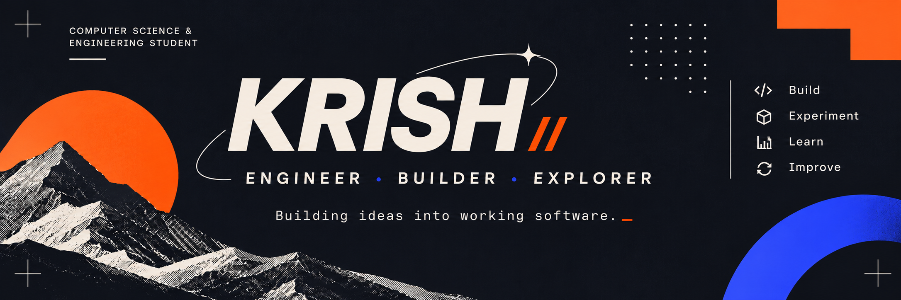

<!-- PERSONAL BANNER -->

  

### Computer Science & Engineering Student

**I build things to understand how they work — and improve them along the way.**

[GitHub](https://github.com/KrishH-KH) · [My Projects](https://github.com/KrishH-KH?tab=repositories)

---

## About

I'm a Computer Science & Engineering student interested in building practical software, understanding backend systems, and exploring how technology can solve real problems.

I enjoy working across the development process — from understanding a problem and designing its logic to implementing features, working with databases, debugging issues, and improving the final product.

My approach is simple: **learn by building, understand by experimenting, and improve through iteration.**

---

## Selected Projects

### 01 — PRICEWISE
**Full-Stack Subscription & Pricing Management Platform**

A web application built to explore subscription management, pricing systems, and administrative workflows.

- Developed with Python and Flask.
- Implemented authentication and role-based access.
- Built dynamic pricing and plan comparison.
- Designed customer and administration dashboards.
- Integrated SQLite database models and REST API endpoints.
- Implemented simulated checkout and coupon validation.

**Stack:** Python · Flask · SQLite · HTML · CSS · JavaScript

[View Repository →](https://github.com/KrishH-KH/pricewise)

---

### 02 — InvestIQ
**Interactive Data Visualisation**

A Python-based project exploring interactive dashboards and data visualisation.

- Built using Plotly Dash.
- Explored interactive data presentation and dashboard development.

**Stack:** Python · Plotly · Dash

*Repository link to be added.*

---

### 03 — Student Feedback System
**Database-Driven Web Application**

A feedback management application designed to connect student feedback workflows with faculty records.

- Developed using PHP and MySQL.
- Implemented feedback submission and database storage.
- Integrated PHPMailer for email notifications.
- Worked on debugging multi-step feedback and email workflows.

**Stack:** PHP · MySQL · PHPMailer · XAMPP

*Repository link to be added.*

---

## Technical Skills

| Area | Technologies |
|---|---|
| Languages | Python, PHP, JavaScript, SQL |
| Web | HTML, CSS |
| Backend | Flask, Flask-SQLAlchemy, REST APIs |
| Databases | MySQL, SQLite |
| Data Visualisation | Plotly, Dash |
| Tools | Git, GitHub, XAMPP |

---

## Areas I'm Exploring

- Backend development and API design
- Database architecture and data management
- Full-stack application development
- Data visualisation and analytical systems
- AI and emerging technologies

---

## How I Build

**Understand → Design → Implement → Test → Improve**

I value understanding the reasoning behind a solution, not simply getting code to run.

I'm interested in the details: how data moves through an application, how systems communicate, why something breaks, and how to make it better.

---

### KRISH //

*Build. Experiment. Learn. Improve.*

<!--
**KrishH-KH/KrishH-KH** is a ✨ _special_ ✨ repository because its `README.md` (this file) appears on your GitHub profile.

Here are some ideas to get you started:

- 🔭 I’m currently working on ...
- 🌱 I’m currently learning ...
- 👯 I’m looking to collaborate on ...
- 🤔 I’m looking for help with ...
- 💬 Ask me about ...
- 📫 How to reach me: ...
- 😄 Pronouns: ...
- ⚡ Fun fact: ...
-->
